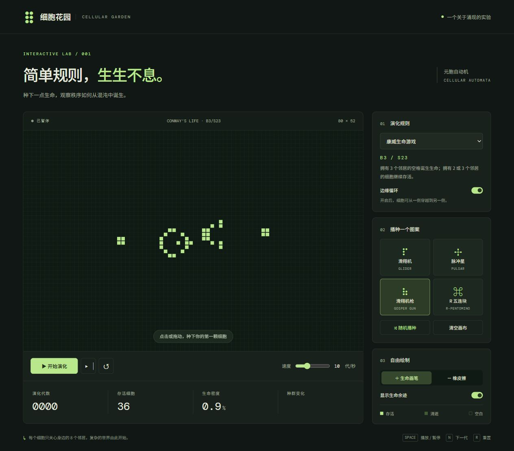

# 细胞花园 · Cellular Garden

一个可以绘制、播种和观察的元胞自动机实验。包含 **Windows 动态桌面壁纸**和可离线运行的**网页 Demo**。

## Windows 桌面壁纸

从 [Releases](https://github.com/534c-100h/cellular-garden/releases) 下载 `cellular-garden-windows-x64-*.zip`，解压到可写目录，双击 `CellularGarden.exe`。

适用于 Windows 10 / 11 x64，使用系统自带的 .NET Framework 4.x；不需要浏览器、服务器、Wallpaper Engine 或 Lively。

- **自动演化**：作为桌面图标后方的动态壁纸运行，通过托盘双击或 `Ctrl+Alt+G` 进入控制模式。
- **可交互画布**：绘制、擦除、平移、缩放；随机播种覆盖当前视野，落笔时自动扩展模拟区域并保留已有细胞。
- **三种规则**：康威生命游戏、HighLife、Seeds，以及滑翔机、脉冲星、滑翔机枪、R 五连块预设。
- **外观个性化**：纯色模式自选细胞和背景颜色；图片模式用细胞显露清晰图片，空白处保留低透明度毛玻璃底图。图片固定在屏幕上。
- **亮暗主题**：跟随系统或手动选择，分别记忆配色；控制面板跟随壁纸颜色。
- **手动输入速度**：支持小数，可切换“秒/代”和“代/秒”，范围为每 60 秒一代至每秒 30 代。
- **独立自动播种**：分别设置静止／重复更新和定时更新的开关、等待时间。
- **日常使用**：暂停／继续、逐代演化、初始状态重置、生命余迹、网格、种群趋势与本机状态保存。

完整操作、快捷键与限制见 [桌面版使用说明](desktop/README.md)。桌面挂载依赖 Windows 桌面窗口结构，系统更新或其他壁纸软件可能影响兼容性；多显示器不同 DPI 场景尚未全面验证。

## 网页 Demo

直接打开 [dist/index.html](dist/index.html)，或安装 Node.js 后在项目根目录运行：

```sh
node serve.cjs
```

访问 <http://127.0.0.1:5173>。网页使用原生 HTML、CSS、JavaScript，无需安装 npm 依赖。

网页版提供基础规则、预设、画笔、余迹与演化控制；动态桌面、图片壁纸和手动输入速度等扩展功能位于 Windows 桌面版。



## 从源码构建

在 Windows PowerShell 或 PowerShell 中运行：

```powershell
./desktop/build.ps1
./desktop/CellularGarden.exe --control
```

默认生成 `desktop/CellularGarden.exe`。编译使用 Windows 自带的 .NET Framework C# 编译器，不需要 Visual Studio。运行中的 EXE 无法覆盖时，可指定其他输出目录：

```powershell
./desktop/build.ps1 -OutputDirectory ./artifacts/development
```

## 测试与打包

需要 Windows x64 和 Node.js。统一检查脚本会在独立输出目录编译，运行网页引擎测试和桌面自检，不改动正在使用的壁纸设置：

```powershell
./scripts/check.ps1
./scripts/package.ps1 -Version 0.1.0
```

桌面自检覆盖演化规则、视野播种、网格扩展、手动速度输入、独立计时、图片定位、模糊背景、配色对比度与设置恢复。打包脚本先运行检查，再生成 Windows 便携包、网页包和 SHA-256 校验文件，输出位于 `artifacts/`。

GitHub Actions 会在推送和 Pull Request 时执行同样的检查，并提供构建产物。

## 项目结构

```text
desktop/              Windows WinForms 程序、渲染引擎、自检与使用说明
dist/                 可直接打开的网页 Demo 源码
docs/assets/          项目预览图片
scripts/              统一检查与发布包生成脚本
.github/workflows/    Windows 构建和测试
serve.cjs             仅监听本机的网页开发服务器
test-engine.cjs       网页引擎测试
```

`desktop/settings*.json`、导入的 `wallpaper-image.png`、运行日志和编译产物不进入 Git；发布包仅包含程序和使用说明，或网页文件。图片导入与状态保存均在本机完成。
